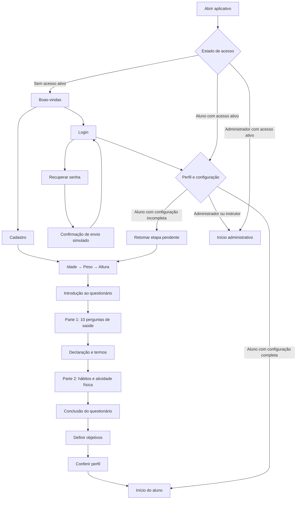

# Proposta de fluxo completo do aplicativo

Proposta para revisão em 27/10/2026. Branch: `feat/conexoes-fluxos`, baseada em `dev` (`42b98a2`). Esta entrega documenta as conexões; ainda não implementa nem integra as telas.

O escopo continua sendo conectar as telas prontas e seus estados de demonstração. Integração com servidor, autenticação real, envio de e-mail e Toolfit ficam para uma etapa posterior.

**Atualização de escopo: telas em produção por outros colegas**

Conforme a orientação do usuário e a lista enviada em 27/10/2026, não desenvolver nem completar as telas abaixo. Reservar os destinos de navegação, mantendo seu conteúdo vazio até receber a entrega correspondente. O mapa de fluxo continua mostrando os destinos finais do produto, mas não autoriza implementar essas telas agora.

| Entrega pendente | Tratamento nesta branch |
| --- | --- |
| Detalhe do exercício, como Supino máquina | Destino reservado e conteúdo vazio; não implementar séries, repetições, descanso, foco muscular ou conclusão |
| Detalhe do treino, como Treino A | Destino reservado e conteúdo vazio; não implementar lista de exercícios nem seção Concluídos |
| Recuperar senha, seus quatro estados/telas | Reservar o acesso pelo login, sem criar formulários, mensagens de erro ou confirmação |
| Objetivos | Reservar os acessos do onboarding, Perfil e Configurações; não criar seleção nem ações de salvar |
| Tamanho da fonte/painel de acessibilidade | Reservar o acionamento; não implementar painel nem controles |
| Alterar senha e editar e-mail | Reservar os acessos em Dados pessoais, sem desenvolver formulários |
| Telas pendentes da área ADM, nove frames mencionados na lista | Não criar novas telas administrativas; manter as entregas prontas preservadas e reservar o que falta |

A imagem enviada não mostra a continuação que discrimina os nove frames da área ADM. Não inventar essa lista. O feed administrativo já entregue não deve ser apagado ou refeito; qualquer conteúdo administrativo ainda em produção permanece pendente.

Os espaços vazios não devem receber um desenho alternativo nem textos de “em desenvolvimento”. Devem apenas permitir retorno à origem pelo mecanismo de navegação comum. Também não substituir ou apagar implementações existentes dos colegas para tornar uma tela vazia: essas implementações ficam preservadas em suas branches, e o destino pendente da integração recebe a entrega quando estiver pronta.

Como Objetivos é uma etapa intermediária pendente, o primeiro acesso não será considerado completamente integrado até sua entrega. Enquanto isso, Perfil e Feed podem ser verificados no cenário de demonstração de aluno já configurado; não pular a etapa de Objetivos silenciosamente nem inventar uma nova tela para contorná-la.

**Como reunir o trabalho da equipe**

- Cada colega continua desenvolvendo e publicando commits na própria branch. Ninguém precisa integrar todas as outras branches no próprio trabalho.
- Buscar e incorporar as entregas prontas exclusivamente em `feat/conexoes-fluxos`, resolvendo conflitos nessa branch.
- Preservar as branches individuais. Trazer atualizações de uma entrega quando seu responsável publicá-las.
- Não depender de permissão para fazer merge na `dev`: esta etapa não modifica nem publica commits nela.
- Não reescrever uma tela pendente para resolver conflito ou liberar uma conexão. Manter seu destino reservado até a entrega do colega.

**O que foi consultado**

Foram atualizadas as referências do repositório e executado `git pull --ff-only` nas cópias de onboarding e feed administrativo. A atualização de fundo `0c86e96` deve ser preservada na integração.

| Área | Origem consultada | Referência |
| --- | --- | --- |
| Base, treinos, exercícios, objetivos, configurações e chat | `dev` e branches `feature/chat`, `feature/configuração`, `feature/meusTreinos` | `42b98a2` |
| Apresentação, cadastro, login, idade e peso | `feat/telas-cadastro-01-a-05` | `d71f99f` |
| Introdução, perguntas de saúde e declaração | `feat/questionario-1` | `5b713f5` |
| Parte 2 e conclusão do questionário | `feat/questionario-2` | `65bc65c` |
| Altura, introdução, termos e perfil | `feat/telas-onboarding-altura-termos-perfil` | `0c86e96` |
| Feed do aluno | `feat/feed` | `0c5211c` |
| Progresso e resultados | `feat/tela-progresso` | `e29c197` |
| Feed administrativo e painéis de atividades | `feat/feed-administrador` | `eae0179` |

Referência de produto: documento do trabalho, RF01–RF12 e protótipos das páginas 27–45. As conexões propostas abaixo seguem esses requisitos; decisões adicionais estão identificadas como propostas.

**1. Entrada e separação de acesso**

“Retomar etapa pendente” deve abrir a etapa exata em que o aluno parou, que pode estar nos dados iniciais, no questionário, nos objetivos ou no perfil. A seta para dados iniciais no diagrama representa o fluxo de configuração como um todo.

- Usuário já configurado não deve responder idade, peso, altura e questionário a cada login.
- Cadastro de aluno leva à configuração inicial. O acesso administrativo não passa pelo questionário do aluno.
- O papel de aluno ou administrador pode ser selecionado por um mecanismo de demonstração para testar as duas experiências, sem representar autenticação real.
- Login inválido ou campo obrigatório vazio mantém a tela atual e mostra seu estado de erro.
- Fluxo final da recuperação: matrícula → estado de erro ou confirmação com e-mail mascarado → voltar ao login. A implementação está com outro colega; nesta etapa, apenas reservar o destino vazio.
- Finalizar a configuração abre o feed e remove as etapas iniciais do histórico de retorno. Dentro da configuração, voltar preserva o que já foi preenchido.

**2. Configuração inicial completa**

Ordem proposta: cadastro → idade → peso → altura → introdução → Parte 1 → declaração/termos → Parte 2 → conclusão → objetivos → perfil → início do aluno.

A Parte 1 apresenta as dez perguntas de saúde previstas em RF05.6–RF05.15, uma por vez. Respostas “Sim” e “Não” ficam selecionadas ao voltar à pergunta anterior. A declaração aparece depois da décima pergunta, com aceite obrigatório para continuar.

A Parte 2 segue esta sequência, já representada na branch `feat/questionario-2`:

1. Por onde conheceu a academia.
2. Motivo de escolha da academia.
3. Frequência semanal pretendida.
4. Tempo sem praticar exercícios.
5. Experiência com musculação/treinamento funcional.
6. Lesão muscular e campo de descrição quando aplicável.
7. Dor articular/muscular e campo de descrição quando aplicável.
8. Hábitos de tabagismo e consumo de álcool.
9. Cirurgia recente e descrição quando aplicável.
10. Confirmação de conclusão → botão “Iniciar” → objetivos.

Não haverá duas introduções nem duas declarações consecutivas. As telas duplicadas entre as branches devem ser conciliadas, mantendo uma única sequência e os desenhos de fundo atualizados. Objetivos e perfil usam as informações de demonstração preenchidas no mesmo fluxo.

**3. Navegação principal do aluno**

Barra inferior comum: **Início · Progresso · MoemIA Fit · Treinos · Perfil**.

| Origem/ação | Destino | Retorno esperado |
| --- | --- | --- |
| Início → iniciar treino | Detalhes do treino do dia | Início, preservando sua posição |
| Início → treino recente | Treino correspondente e seus exercícios | Início |
| Início → inscrever em uma aula | Confirmação → estado inscrito | Mesmo card no início |
| Início → sair de uma aula | Confirmação → estado não inscrito | Mesmo card no início |
| Cancelar inscrição/saída no diálogo | Fechar diálogo sem mudar o estado | Mesmo card |
| Progresso → escolher período | Mesma tela com indicadores e gráfico do período | Manter o período escolhido |
| Progresso → treino anterior | Detalhes daquele treino histórico | Progresso, com o período mantido |
| MoemIA Fit | Chat existente | Área de origem ou outra aba selecionada |
| Treinos → selecionar ficha A/B/C/D | Detalhes da ficha selecionada | Lista de treinos |
| Ficha → selecionar exercício | Detalhes do exercício selecionado | A mesma ficha |
| Exercício → concluir | Atualizar indicação visual na ficha | A mesma ficha, preservando os outros exercícios |
| Exercício → vídeo/foco muscular | Conteúdo do exercício atual | Detalhes do mesmo exercício |
| Perfil → objetivos, “+” ou “Ver tudo” | Objetivos | Perfil |
| Perfil → resultados, “+” ou “Ver tudo” | Progresso/Meus Resultados | Perfil |
| Perfil → meu treino, miniatura ou “Ver tudo” | Lista de treinos/ficha correspondente | Perfil |
| Perfil → engrenagem | Configurações | Perfil |
| Perfil → foto | Seleção/prévia de foto, quando incluída na etapa visual | Perfil |

A aba Perfil sempre abre o perfil do usuário; Configurações fica acessível pela engrenagem. Treinos históricos devem ser tratados como consulta, sem alterar o estado de uma sessão de treino atual. Os detalhes de treino/exercício e a tela de Objetivos permanecem vazios nesta integração enquanto aguardam as entregas indicadas na atualização de escopo.

**4. Configurações e retornos**

| Caminho | Conclusão/cancelamento |
| --- | --- |
| Perfil → Configurações → Dados pessoais | Voltar para Configurações |
| Dados pessoais → Ver meu perfil | Abrir o mesmo perfil do usuário |
| Dados pessoais → editar e-mail | Confirmar estado de sucesso ou cancelar → Dados pessoais |
| Dados pessoais → alterar senha | Confirmar estado de sucesso ou cancelar → Dados pessoais |
| Configurações → Notificações | Alternar estados visuais → voltar para Configurações |
| Configurações → Objetivos | Confirmar/cancelar → origem; atualização visual refletida no Perfil |
| Configurações → Refazer questionário de saúde | Parte 1 → declaração/termos → Configurações |
| Configurações → Sair da conta | Encerrar estado de acesso demonstrativo → Login |

Refazer o questionário de saúde não reinicia cadastro, idade, peso, altura, Parte 2 e definição de objetivos. Essa distinção segue RF08.17. Um diálogo de confirmação de saída é uma proposta de interação, não uma tela adicional exigida pelo documento.

**5. Navegação do administrador/instrutor**

Barra inferior proposta com base no feed e na agenda do protótipo: **Início · Agenda · MoemIA Fit · Treinos · Perfil**. A tela de Treinos da página 45 apresenta “Progresso” na segunda posição, diferentemente de Início/Agenda; propõe-se usar Agenda de forma consistente na área administrativa, sem reaproveitar o progresso pessoal do aluno.

| Origem/ação | Destino | Retorno esperado |
| --- | --- | --- |
| Início → Ver atividade | Painel da próxima atividade | Recolher → Início |
| Atividade de hoje → selecionar card | Painel da atividade escolhida | Fechar → mesma lista |
| Painel → professor ou status | Seletor correspondente | Voltar ao mesmo painel |
| Painel → cancelar atividade | Estado de confirmação proposto | Confirmar/cancelar → tela de origem |
| Início → adicionar atividade | Formulário/painel visual | Confirmar/cancelar → Início |
| Formulário → horário/data | Seletor de horário e calendário | Mesmo formulário com estado visual preservado |
| Formulário → professor/vagas/status | Seletores existentes | Mesmo formulário |
| Agenda → dia da semana | Atividades daquele dia, incluindo hoje/amanhã | Manter dia selecionado |
| Agenda → atividade | Mesmo painel de detalhes usado no início | Agenda, mantendo o dia |
| Agenda → adicionar atividade | Mesmo formulário, no contexto do dia escolhido | Agenda |
| Treinos → ficha A/B/C/D | Detalhes do treino → exercício | Lista administrativa de treinos |
| MoemIA Fit | Chat existente | Área de origem |
| Perfil | Dados do instrutor logado e acesso a Configurações | Área de origem |
| Configurações → Sair | Login | Sem retorno às telas internas pelo botão Voltar |

Agenda é uma tela de atividades, conforme a página 44. O calendário é um seletor dentro do formulário, não o destino principal da aba Agenda. Na área administrativa, Perfil e Configurações não devem mostrar o questionário nem os resultados pessoais de um aluno fictício.

Criação geral de fichas, gerenciamento de alunos e integração de exercícios com Toolfit não serão acrescentados como telas novas sem uma definição de escopo: o documento atribui esse gerenciamento ao sistema institucional.

**6. Lacunas e correções identificadas**

| Situação atual | Conexão necessária |
| --- | --- |
| Login do cadastro leva sempre para idade | Encaminhar por perfil e configuração inicial |
| Altura no grafo de cadastro é uma tela provisória | Abrir a roleta de altura existente |
| Altura da entrega isolada abre Perfil | Abrir a introdução do questionário no primeiro acesso |
| Introdução da entrega isolada abre Termos | Abrir a primeira pergunta de saúde |
| Gerenciador da Parte 1 muda para uma etapa sem conteúdo após a declaração | Conectar a declaração à Parte 2 |
| Termos da entrega isolada retorna para altura | Encaminhar para Parte 2 ou Configurações conforme a origem |
| Parte 2 já termina em Objetivos | Completar Objetivos → Perfil → Início no primeiro acesso |
| Perfil ainda tem ações sem destino e “Salvar” volta para altura | Conectar objetivos/resultados/treinos e concluir a configuração no feed |
| Alguns atalhos Perfil abrem Configurações diretamente | Abrir Perfil e manter a engrenagem para Configurações |
| Progresso possui callbacks sem conexões completas | Ligar todas as abas, chat e histórico |
| Agenda administrativa abre apenas calendário | Reservar o destino de Agenda e aguardar a entrega administrativa; não criar a tela |
| Treinos administrativos abre a experiência do aluno | Reservar o destino administrativo correspondente e aguardar sua entrega |
| Recuperação ainda é uma tela provisória | Manter o destino reservado e vazio; aguardar os quatro estados/telas do colega |
| Edição de e-mail e alteração de senha ainda estão em produção | Reservar os destinos vazios; não criar os formulários |
| Outras telas de Dados pessoais e notificações precisam ser conferidas | Integrar apenas entregas existentes e prontas; não preencher lacunas com novas telas sem definição de escopo |

**7. Regras gerais para a integração**

- Uma única entrada do aplicativo, com destinos definidos para aluno e administrador.
- Toda seta Voltar e o retorno do Android devem levar à origem correta. Objetivos, detalhes de treino e painéis precisam saber de onde foram abertos.
- Trocar de aba não deve empilhar cópias de telas nem perder seleção, rolagem, respostas ou estado visual de conclusão.
- Depois de login ou configuração inicial, Voltar não deve reabrir cadastro. Depois de sair, Voltar não deve reabrir uma área interna.
- A aba atual permanece destacada em todas as telas de sua área.
- Cancelar um diálogo ou formulário não deve aplicar alterações de demonstração.
- Identidade, papel, altura, peso e seleções de demonstração devem ser compartilhados entre as telas. Não misturar Lucas/aluno com Amanda/instrutora durante a navegação.
- As branches atuais misturam Compose e XML/Activities, além de possuírem pacotes e configurações diferentes. A integração deve conciliar os destinos sem sobrescrever os trabalhos da equipe nem duplicar as telas.
- Preservar a padronização mais recente de cores, fontes, componentes e formas do background.
- Manter o trabalho em `feat/conexoes-fluxos`, sem merge na `dev` nem alteração das branches individuais.

**8. Ordem proposta para implementar após a revisão deste mapa**

1. Conciliar estrutura, configurações de build e entrada do aplicativo.
2. Conectar boas-vindas, cadastro e login prontos; reservar a recuperação vazia.
3. Conectar dados iniciais e questionários prontos, reservando Objetivos e respeitando a origem dos retornos.
4. Conectar as áreas prontas do aluno; detalhes de treino e exercício ficam reservados e vazios.
5. Conectar as entregas prontas de configurações; reservar alteração de senha, edição de e-mail e painel de fonte.
6. Preservar e conectar somente as entregas administrativas prontas; não desenvolver as telas ADM ainda em produção.
7. Testar os caminhos disponíveis, o retorno dos destinos vazios, a separação aluno/administrador, saída e rotação. Registrar quais percursos continuam bloqueados por entregas pendentes.
8. Quando cada colega concluir e publicar sua entrega, substituir somente o destino reservado correspondente e testar o fluxo que ela libera.

Critério da integração atual: toda tela pronta tem conexões e retornos coerentes; as entregas pendentes da equipe têm destinos reservados, conteúdo vazio e retorno funcional. Esses espaços são exceções explícitas solicitadas pelo usuário e não devem ser apresentados como fluxos já concluídos. As telas prontas devem ser acessíveis a partir da entrada do aplicativo, sem depender da execução isolada de uma Activity no Android Studio.
